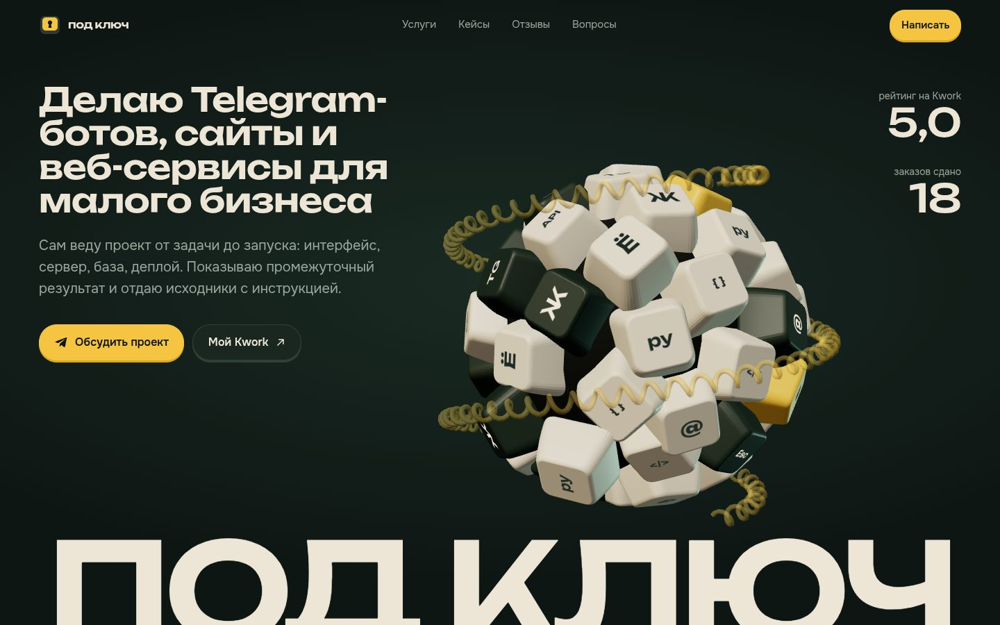
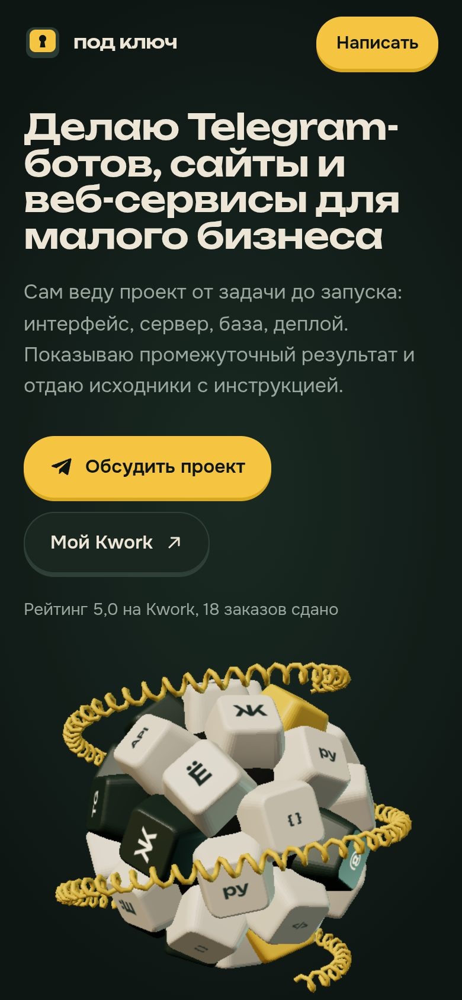

# Под ключ: сайт-портфолио Александра

Сайт, который продаёт меня как разработчика «под ключ»: Telegram-боты, лендинги, сайты, веб-приложения и CRM, парсеры и автоматизация, AI-агенты. Открыл, посмотрел работы и отзывы, написал в Telegram или открыл Kwork.

**Живая ссылка:** https://alexandrcherezau.github.io/





## Что внутри

- Первый экран с 3D-шаром из клавиш: клавиши слетаются по мере загрузки, шар реагирует на курсор, наклон телефона и скролл. При повторном визите сборка пропускается.
- Услуги с ценами и сроками из моих кворков, кнопки ведут на конкретный кворк или в Telegram с готовым текстом.
- Кейсы с фильтром и модальным окном с галереей. Демо и концепты подписаны.
- Отзывы с Kwork слово в слово, блок Kwork, FAQ, финальный призыв написать.
- Без WebGL, при программном рендеринге или ошибке загрузки вместо 3D показывается статичный постер, сайт и кнопки работают как обычно. При `prefers-reduced-motion` анимации минимальные.

## Стек

Next.js 16 (App Router, статический экспорт), React 19, TypeScript, Tailwind CSS 4, three.js + @react-three/fiber + drei, motion, Lenis, Radix Dialog (по образцу shadcn/ui). Сервер не нужен: после сборки это обычные HTML, CSS и JS.

## Как запустить локально

Нужен Node.js 20.9 или новее.

```bash
npm install
npm run dev        # http://localhost:3000
npm run build      # статическая сборка в папку out/
npm run typecheck  # проверка типов
npm run lint       # линтер
```

Посмотреть собранную версию: `npx serve out`.

Для отладки 3D на машине без видеокарты добавьте к адресу `?3d=force`: без этого параметра при программном рендеринге показывается постер.

## Как поменять контент без кода

Весь текст лежит в `src/content/`:

| Файл | Что там |
|---|---|
| `site.json` | имя, Telegram, Kwork, GitHub, тексты первого экрана и финального блока |
| `services.json` | услуги: что входит, срок, цена «от», ссылка на кворк, текст для Telegram |
| `cases.json` | кейсы: задача, решение, стек, результат, ссылки и скриншоты |
| `reviews.json` | отзывы с Kwork и статистика профиля (рейтинг, число заказов) |
| `kworks.json` | популярные кворки для блока Kwork |
| `process.json` | шаги «как идёт работа» |
| `faq.json` | вопросы и ответы |

Скриншоты кейсов лежат в `public/cases/` (формат WebP). Чтобы добавить кейс, положите картинки `имя-1.webp`, `имя-2.webp` и обложку `имя-cover.webp` (960×720) и допишите объект в `cases.json`. После правок закоммитьте изменения: сайт пересоберётся сам.

Отзывы копируйте с Kwork дословно, без исправлений.

## Деплой

GitHub Actions (`.github/workflows/deploy.yml`) на каждый пуш в `main` ставит зависимости, проверяет типы и линтер, собирает сайт и публикует папку `out/` на GitHub Pages. Отдельный хостинг и аккаунты не нужны.

Если захочется разместить сайт в подпапке (например, `имя.github.io/portfolio`), задайте переменную `NEXT_PUBLIC_BASE_PATH=/portfolio` при сборке. Иконки, OG-картинку, `robots.txt`, `sitemap.xml` и `site.webmanifest` в этом случае нужно поправить вручную: сейчас они рассчитаны на корень домена.

## 3D-ассеты

Модель клавиши генерируется скриптом `scripts/gen-keycap.mjs` (three.js) и сжимается gltf-transform с meshopt (`npm run assets:keycap`, 13 КБ). Атлас символов на клавишах рисует `scripts/gen-atlas.mjs` шрифтом Unbounded (`npm run assets:atlas`, нужен Chromium в `CHROME_PATH`). Кабель строится в браузере процедурно. Сторонних 3D-моделей нет. Подробности и лицензии в [CREDITS.md](CREDITS.md).

## Документы

- [SPEC.md](SPEC.md): цель, аудитория, секции, дизайн-токены, критерии готовности.
- [PLAN.md](PLAN.md): этапы с проверками.
- [artifacts/REPORT.md](artifacts/REPORT.md): отчёт о сборке и проверках.
